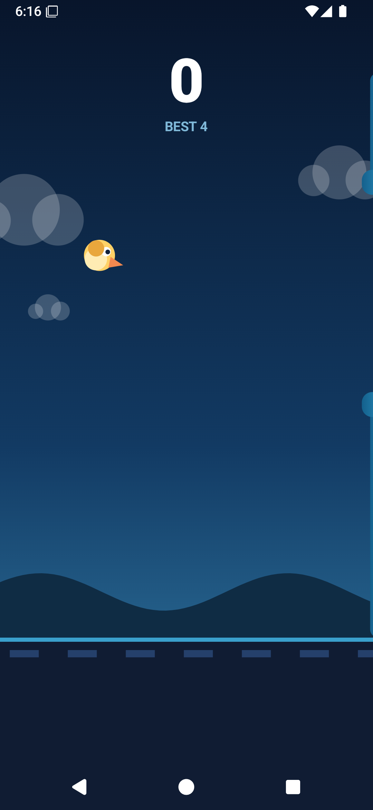
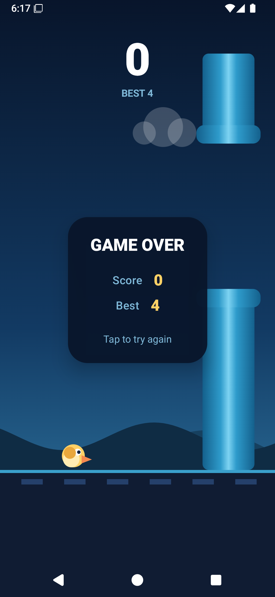

# Sky Dodger

[](https://github.com/stoner-lab/Sky-Dodger/actions/workflows/android.yml)

An offline endless-flyer for Android. Tap to flap, slip through the pipes, beat your
best score. No ads, no analytics, no accounts, and no `INTERNET` permission at all -
the game runs completely on the device.

Built as a portfolio project to show clean Android architecture: a pure-Kotlin
simulation, a thin Compose layer, and tests that do not need a device.

<p align="center">
  
  
</p>

## Features

- One-tap control: tap to flap, tap to restart.
- Endless pipe field with a hole that always stays inside the playable area.
- Difficulty ramps up over the first 45 seconds, then holds.
- Best score persisted locally with `SharedPreferences`.
- Everything is drawn on a Compose `Canvas` - no image assets, no sprite sheets, so
  the APK stays small and the game scales to any screen.
- Screen stays awake while playing.

## Tech stack

| Part | Choice |
| --- | --- |
| Language | Kotlin 2.2.10 |
| UI | Jetpack Compose (BOM 2025.09.00), Material 3 |
| Build | AGP 8.13.0, Gradle 8.14.3, JDK 17+ |
| SDK | `minSdk 24`, `compileSdk`/`targetSdk 36` |
| Tests | JUnit 4 (JVM unit tests, no instrumentation needed) |

## How it works

The simulation lives in `game/` and knows nothing about Android. It runs in a fixed
360 x 640 world, and the canvas scales that world to the screen, so physics behave the
same on a 5" phone and on a tablet. Screen size never leaks into gameplay.

```
app/src/main/java/com/duy/skydodger/
├── game/GameConfig.kt      tunable constants (gravity, pipe speed, world size)
├── game/GameWorld.kt       immutable world snapshot + pure update() step
├── ui/GameHolder.kt        Compose bridge: frame loop, score, phase, restart guard
├── ui/GameScreen.kt        canvas + tap input + per-frame simulation
├── ui/GameHud.kt           score, best, ready and game-over panels
├── ui/BackgroundRenderer.kt  sky, clouds, parallax hills
├── ui/SpriteRenderer.kt    pipes, ground, bird
├── ui/GamePalette.kt       colours
└── data/ScoreStore.kt      best score persistence
```

A frame is one call to `GameWorld.update(delta)`, which returns the next immutable
snapshot. Because the step is a pure function, the tests can drive the whole game
without an emulator:

- gravity and flap impulses
- ceiling clamp and ground death
- circle-vs-rect collision against both pipe blocks
- a pipe scoring exactly once
- gap generation staying inside the playable area
- the step clamp that stops a long frame from tunnelling the bird through a pipe

Rendering is deliberately separated from state. `GameHolder` exposes the world as a
plain field read inside the draw lambda, and only a small snapshot clock triggers
invalidation, so a frame redraws the canvas without recomposing the screen.

## Build

```bash
./gradlew :app:assembleDebug        # APK at app/build/outputs/apk/debug/
./gradlew :app:testDebugUnitTest    # 14 JVM tests
```

`local.properties` needs `sdk.dir=` pointing at your Android SDK; it is git-ignored.

## Dev helper

`tools/install-and-screenshot.ps1` builds the APK, boots the `SkyDodger` AVD, installs
the game, plays it with a few taps and saves screenshots into `docs/screenshots`.
Windows only; the emulator and system image must be installed in the Android SDK.

## Roadmap

- [ ] Sound effects and haptic feedback on flap and crash
- [ ] Day / night themes
- [ ] Coins and unlockable bird skins
- [ ] Accessibility pass: screen reader labels, reduced-motion mode

## License

MIT. See [LICENSE](LICENSE).
